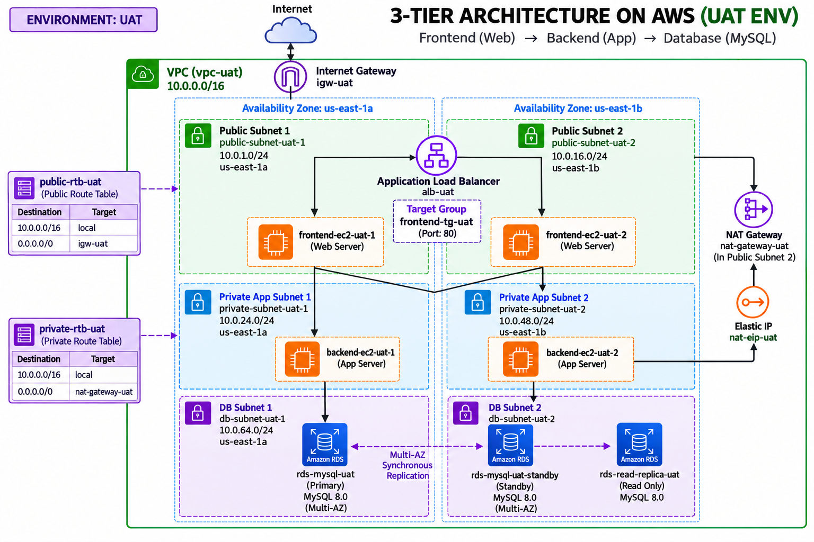
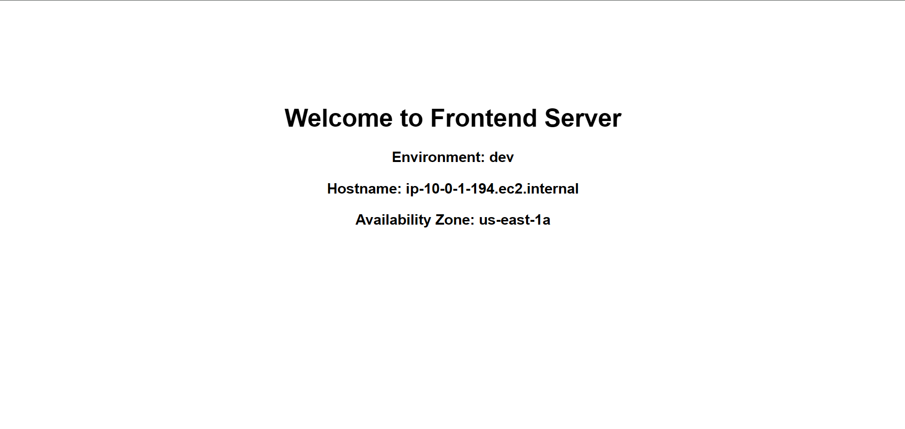
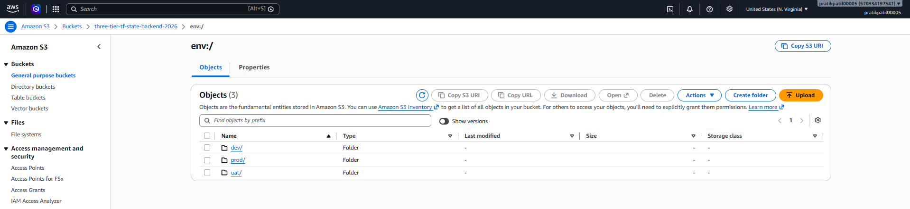

# Three-Tier AWS Infrastructure as Code with Terraform

[](https://github.com/Pratik02-07/Three-Tier-AWS-Infrastructure-as-Code-with-Terraform/actions/workflows/terraform.yml)
[](https://www.terraform.io/)
[](https://aws.amazon.com/)
[](https://ubuntu.com/)


A production-ready, highly available, and secure three-tier cloud architecture provisioned on AWS using **Terraform** and the official **AWS Provider**.

---

## 🏗️ Architecture Blueprint



### Application Load Balancer

The public-facing Application Load Balancer receives HTTP/HTTPS traffic and
routes requests to the frontend tier. The frontend and backend security groups
remain private to their respective tiers.



### Remote Backend and State Locking

Terraform state is stored remotely in an encrypted S3 bucket. DynamoDB
provides distributed state locking so concurrent changes to an environment are
serialized and protected from state corruption.



---

## 📁 Repository Structure

```text
.
├── global/
│   └── s3_backend/             # Standalone S3 remote state bucket (encrypted/versioned) & DynamoDB lock table
├── modules/
│   ├── network/                # VPC, Subnets (Public, App Priv, DB Priv), IGW, NAT GW, Route Tables
│   ├── compute/                # ALB, Launch Templates (AL2023, SSM Profile), Frontend ASG, Backend ASG, SGs
│   └── database/               # RDS PostgreSQL 15.7, DB Subnet Group, Restricted DB Security Group
├── envs/
│   ├── dev/                    # Development environment (Single-AZ DB, 1-3 ASG)
│   ├── uat/                    # User Acceptance Testing environment (Staging mirror)
│   └── prod/                   # Production environment (Multi-AZ DB, 2-6 ASG)
├── docs/
│   ├── images/image.png        # Architecture Blueprint
│   ├── superpowers/specs/      # Design Specifications
│   └── superpowers/plans/      # Step-by-Step Implementation Plans
├── .gitignore                  # Excludes *.tfstate, .terraform/, *.tfvars
└── .tflint.hcl                 # AWS Terraform linter configuration
```

---

## 🔒 Key Architectural & Security Principles

1. **Zero Open SSH (Port 22 Eliminated):**
   * EC2 instances attach an IAM role with `AmazonSSMManagedInstanceCore`.
   * Secure shell administration is performed via **AWS Systems Manager (SSM) Session Manager** directly from the AWS Console or AWS CLI (`aws ssm start-session --target <instance-id>`). No `.pem` keys or open inbound ports are required.
2. **Strict Security Group Chaining (Least Privilege):**
   * `Internet` → `ALB SG` (Ports 80/443).
   * `ALB SG` → `Frontend SG` (Port 80 only).
   * `Frontend SG` → `Backend SG` (Port 8080 only).
   * `Backend SG` → `Database SG` (Port 5432 only).
3. **IMDSv2 Enforced:**
   * Both Frontend and Backend Launch Templates mandate IMDSv2 (`http_tokens = "required"`), neutralizing SSRF attack vectors.
4. **Dynamic AMI Resolution:**
   * Uses `data "aws_ami" "amazon_linux_2023"` to always deploy the latest patched Amazon Linux 2023 release across any AWS region.
5. **State Locking & Blast Radius Isolation:**
   * Each environment operates with its own isolated S3 state key (`dev/terraform.tfstate`, `uat/terraform.tfstate`, `prod/terraform.tfstate`) and DynamoDB distributed state locking.

---

## 🚀 Quick Start Guide

### CI Validation Workflow

The `Terraform CI` workflow performs `terraform fmt -check`, initializes each
selected environment against its S3 backend, selects or creates the required
Terraform workspace, and runs `terraform validate`. It never runs
`terraform plan` or `terraform apply`.

Configure the repository secrets `AWS_ACCESS_KEY_ID` and
`AWS_SECRET_ACCESS_KEY` before enabling CI validation.

| Branch | Environments validated | Workspace |
| :--- | :--- | :--- |
| `main` | `envs/dev`, `envs/uat`, `envs/prod` | `default` |
| `dev` | `envs/dev` | `dev` |
| `uat` | `envs/uat` | `uat` |
| `prod` | `envs/prod` | `prod` |

### Branch and Workspace Management

Each environment has its own Git branch, Terraform configuration directory,
S3 state key, and Terraform workspace:

| Git branch | Terraform directory | S3 state key | Terraform workspace |
| :--- | :--- | :--- | :--- |
| `main` | `envs/dev`, `envs/uat`, `envs/prod` | `dev/`, `uat/`, and `prod/` state keys | `default` |
| `dev` | `envs/dev` | `dev/terraform.tfstate` | `dev` |
| `uat` | `envs/uat` | `uat/terraform.tfstate` | `uat` |
| `prod` | `envs/prod` | `prod/terraform.tfstate` | `prod` |

The branch-to-workspace flow is illustrated below:


#### Initial setup

Run these steps after provisioning the S3 bucket and DynamoDB lock table:

```powershell
# Create and publish the environment branches
git switch -c dev
git push -u origin dev

git switch main
git switch -c uat
git push -u origin uat

git switch main
git switch -c prod
git push -u origin prod

# Return to the protected integration branch
git switch main
```

Create the matching remote Terraform workspaces. The `default` workspace is
used by `main`; the environment branches use their named workspace:

```powershell
foreach ($environment in @("dev", "uat", "prod")) {
  Set-Location "envs\$environment"
  terraform init -reconfigure
  terraform workspace select $environment 2>$null
  if ($LASTEXITCODE -ne 0) {
    terraform workspace new $environment
  }
  Set-Location ..\..
}
```

To inspect the active workspace or switch workspaces manually:

```powershell
terraform workspace show
terraform workspace list
terraform workspace select dev
```

#### Normal workflow

1. Create a feature branch from the environment branch you intend to change.
2. Make and review the Terraform change.
3. Merge the change into `dev`, `uat`, or `prod`, or push directly to the
   environment branch according to your repository protection rules.
4. GitHub Actions initializes the S3 backend, selects the matching workspace,
   and runs formatting and validation checks for that branch.
5. Promote approved changes to `main` when appropriate.
6. The `main` workflow validates all three environments with their
   `default` workspaces.

CI requires the repository secrets `AWS_ACCESS_KEY_ID` and
`AWS_SECRET_ACCESS_KEY`. The validation workflow does not run
`terraform plan` or `terraform apply`.

### 1. Provision Remote State Backend (Run Once)
```powershell
cd global/s3_backend
terraform init
terraform apply
```

### 2. Deploy Infrastructure (e.g., Development)
```powershell
cd ../../envs/dev
cp terraform.tfvars.example terraform.tfvars
# Update terraform.tfvars with your database password
terraform init
terraform plan
terraform apply
```

---

## 💰 Cost Estimation (Free Tier Compatibility)

| Service | Free Tier Allowance | Dev / UAT Est. Cost | Prod Est. Cost | Notes |
| :--- | :--- | :--- | :--- | :--- |
| **EC2 (`t3.micro`)** | 750 hrs/month | Free Tier eligible | Scaled (`t3.small`) | Covered in AWS 12-month free tier |
| **RDS (`db.t3.micro`)** | 750 hrs/month + 20GB | Free Tier eligible | ~$30/mo (`db.t3.small`, Multi-AZ) | Single-AZ in Dev/UAT saves cost |
| **S3 & DynamoDB** | 5GB S3 + 25GB DDB | $0.00 / month | $0.00 / month | Well within free tier limits |
| **ALB** | 750 hrs/month (new accts) | Free Tier eligible | ~$16.20 / month | Standard AWS ALB pricing |
| **NAT Gateway** ⚠️ | None | ~$32.40 / month | ~$32.40 / month | Charged hourly ($0.045/hr) |


---

## 🧹 Teardown Runbook

To destroy cloud resources cleanly:

```powershell
# 1. Destroy environment resources
cd envs/dev
terraform destroy -auto-approve

# 2. Destroy remote backend (when completely decommissioning project)
cd ../../global/s3_backend
terraform destroy -auto-approve
```